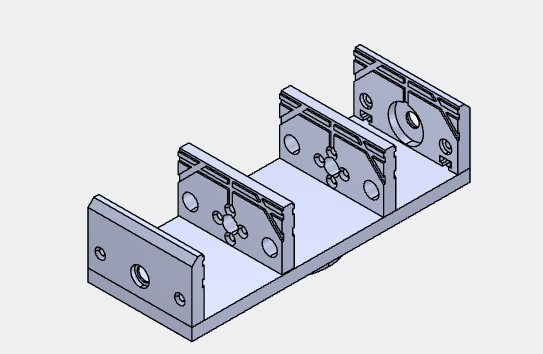
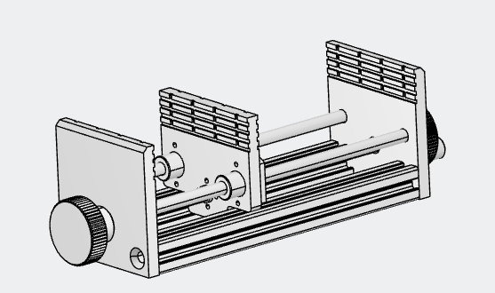
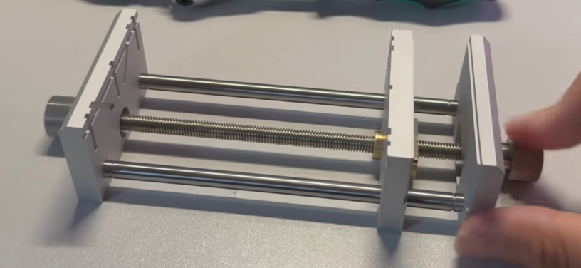

## PCB焊接夹具

### 需求分析

目前需要一个新的PCB的焊接夹具，原来的太久卡顿不好用了，找了找淘宝上卖成品都40+，好一点的上百块，尺寸也有限制；正好看到网上也有大佬用嘉立创CNC自己制作的，价格差不多但用料和夹取尺寸会好很多，那就参考目前的方案，进行二次开发。

首先是夹取的尺寸可以方便扩展，零件配件容易获得，在此基础上尽量做到低成本，保证功能性的前提下结构尽量简单。

目前大佬的设计有下面这几种

1. [PCB夹具-A锋-嘉立创FA机械电气零部件商城-嘉立创机电工坊](https://www.jlc-jdgf.com/machine-detail/576368165096771587)

   

   下面有固定的支撑板，底下有磁吸的旋转定位装置，夹板对向移动有三个夹取的区域，很好的结构设计，据反馈现在嘉立创加工会超时了(2026.06)，不是太需要旋转功能，底板受限于加工的尺寸限制，做不了太大。

2. [PCB夹具-嘉立创FA机械电气零部件商城-嘉立创机电工坊](https://www.jlc-jdgf.com/machine-detail/564835813840285698)

   

   将下面的支撑板用2020型材替代了，材料更容易购买，降低了成本。

3. [zhangbokang/PCB_Fixture: 使用五金标准件和简单CNC件组成的PCB夹具。PCB fixture composed of hardware standard parts and simple CNC parts.](https://github.com/zhangbokang/PCB_Fixture)

   

   这个结构很简洁，用到都是标准件，CNC只需要做一次两片，零件容易购买。

4. [成功复刻改版T6小夹具_哔哩哔哩_bilibili](https://www.bilibili.com/video/BV1nPkCBZEem/?spm_id_from=333.337.search-card.all.click&vd_source=96b016db6a7ef870ec8f2ba89f171caf)

   抖音上的大佬的T6夹具设计的很符合预期，不要底板靠光轴支撑，降低成本，B站又有改进设计，原版的夹取固定方式做不到和表面齐平，将其中一侧改成了台阶的方式，就可以夹着板子上钢网了。

   

### 原型设计

参考前人大佬的设计，在T6的基础上进行修改，因此有了两个版本，小尺寸仍沿用6mm光轴和T6丝杆，尺寸在100mm左右，扩展了CNC板宽由6cm改为8cm，修改了夹取台阶的设计，适配大部分PCB厚度。大尺寸改用8mm光轴和T8丝杆，尺寸在300mm左右，用来夹持大尺寸的板子，8mm光轴可扩展10mm光轴进一步增加强度，这样一般的使用场景就都够用了。

成本下来预计50左右。

#### T6版本

| 配件                 | 长度价格    | 长度价格             |
| -------------------- | ----------- | -------------------- |
| 6mm光轴X2            | 120mm 4.2￥ | 160mm  11￥(5￥运费) |
| T6丝杆带螺母         | 150mm  7￥  | 200mm 10￥           |
| MR106轴承6x10x3X2    | 2.1￥       |                      |
| 铝合金手轮X2         | 5￥         |                      |
| 石墨铜套自润滑轴承X2 | 5￥         |                      |
| M6垫片螺丝           | 1￥         |                      |
| 总计                 | 24.3￥      | 34.1￥               |
| CNC加工              |             |                      |

#### T8版本

| 配件                 | 长度价格             | 长度价格    | 长度价格     |
| -------------------- | -------------------- | ----------- | ------------ |
| 8mm光轴X2            | 160mm  4.4￥         | 220mm 6￥   | 250mm 11.6￥ |
| T8丝杆带螺母         | 200mm 5.8￥          | 250mm 6.4￥ | 300mm 8￥    |
| 轴承8x12x3.5mm       | 2.5￥                |             |              |
| 铝合金手轮X2         | 5￥                  |             |              |
| 石墨铜套自润滑轴承X2 | 5.8￥                |             |              |
| M8垫片螺丝           | 1￥                  |             |              |
| 总计                 | 24.5￥               | 26.7￥      | 33.9￥       |
| CNC加工              | 14￥（没有活动26￥） |             |              |

这样算下来还是T8版本的更有性价比，看需要大一些的还是小一些的吧，决定两种做哪个。

### 具体实现

建模后的3D模型如下：

### 迭代优化

V1.1

1. 修改梯形丝杆螺母的孔径为10.5mm，实际装配时发现孔比较小无法直接安装进去，需要打磨。
2. 修改两侧轴承内孔，避免和外壳摩擦。
3. 修改完成，制作验证完成。

### 资料打包

以220mm长光轴版本举例：

| 配件                               | 价格           | 购买链接                                                     |
| ---------------------------------- | -------------- | ------------------------------------------------------------ |
| 8mm光轴220mm X2                    | 2.6￥x2=5.2￥  | [光轴 导柱 轴承杆 光轴diy配件 滑杆电镀导轨 支撑柱8mm导 柱耐磨 - 阿里巴巴](https://detail.1688.com/offer/1016948173878.html?spm=a360q.8274423%2Fnew.goods.productname) |
| T8丝杆带螺母 250mm                 | 6.4￥          | [3D打印机丝杆 T8型梯形丝杆 304不锈钢全牙步进电机丝杠螺母导程8-淘宝网](https://item.taobao.com/item.htm?id=794012596512) |
| MR128ZZ轴承8x12x3.5mm X2           | 0.8￥x2=1.6￥  | [微型小轴承MR115 MR117 MR125 MR126 MR128 MR137 MR138 MR148ZZ-淘宝网](https://item.taobao.com/item.htm?id=1013487111440&sku_properties=122276018%3A20213) |
| 铝合金手轮   外径20孔径8mm X2 | 3.4￥x2=6.8￥  | [铝合金滚花手轮网纹圆形带摇把转动盘活动机床滑台机械手柄手轮盘-淘宝网](https://item.taobao.com/item.htm?abbucket=4&id=848447517560) |
| 石墨自润滑轴承 8x12x8mm            | 2￥x2=4￥      | [石墨铜套耐磨衬套自润滑轴承无油内径4 5 6 8 10高力黄铜12 16-50-tmall.com天猫](https://detail.tmall.com/item.htm?abbucket=4&id=680762713463) |
| 8mm弹簧垫片薄款                    | 0.5￥          | [镀锌薄形弹簧垫片垫圈开口弹垫金属介子弹性垫片M2M3M4M5M6M8-M10-tmall.com天猫](https://detail.tmall.com/item.htm?id=604677659158) |
| M4小沉头螺丝 M4x10x5 x6       | 0.5￥          | [304不锈钢小沉头十字螺丝FM小头径非标薄平头螺钉M1.6M2M2.5M3M4-tmall.com天猫](https://detail.tmall.com/item.htm?id=810764799998&skuId=6069553041558) |
| CNC板加工（一次做3块)              | (0+0+10+4)14￥ |                                                              |
| 总计                               | 40￥           |                                                              |
| 使用淘宝88VIP红包 总计             | 28￥           | 小配件使用88VIP的2元红包，就只用几毛钱。                     |

