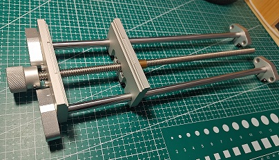
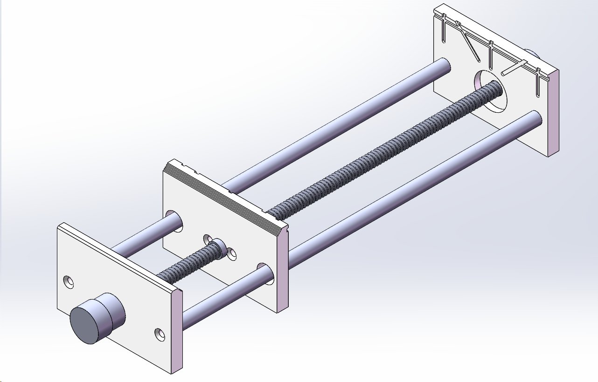

# PCB 焊接夹具

## 需求分析

需要一个新的 PCB 焊接夹具。原来的用久了卡顿不好用；淘宝上的成品普遍 40 元起，好一点的过百，尺寸也有限制。正好看到有人用嘉立创 CNC 自己做，价格相近但用料和夹持尺寸好很多，于是参考现有方案进行二次开发。

设计目标：

- 夹持尺寸方便扩展
- 零件配件容易购买
- 尽量低成本
- 保证功能的前提下结构尽量简单

目前参考的设计有以下几种。

### 1. 嘉立创 A锋 PCB 夹具

[PCB夹具-A锋-嘉立创FA机械电气零部件商城-嘉立创机电工坊](https://www.jlc-jdgf.com/machine-detail/576368165096771587)

底部是固定的支撑板，下面带磁吸旋转定位装置，夹板对向移动形成三个夹持区域，结构设计很好。据反馈嘉立创加工会超时（2026.06）；另外不需要旋转功能，底板又受加工尺寸限制做不大。

### 2. 嘉立创 2020 型材版 PCB 夹具

[PCB夹具-嘉立创FA机械电气零部件商城-嘉立创机电工坊](https://www.jlc-jdgf.com/machine-detail/564835813840285698)

把下面的支撑板换成 2020 型材，材料更容易购买，成本也更低。

### 3. zhangbokang/PCB_Fixture

[zhangbokang/PCB_Fixture：使用五金标准件和简单 CNC 件组成的 PCB 夹具](https://github.com/zhangbokang/PCB_Fixture)

结构很简洁，用的都是标准件，CNC 只需要做一次两片，零件容易购买。

### 4. B 站改版 T6 小夹具

[成功复刻改版 T6 小夹具 - 哔哩哔哩](https://www.bilibili.com/video/BV1nPkCBZEem/?spm_id_from=333.337.search-card.all.click&vd_source=96b016db6a7ef870ec8f2ba89f171caf)

抖音上的 T6 小夹具设计很符合预期：不要底板，靠光轴支撑，降低成本。B 站又有改进设计——原版的夹持方式做不到与上表面齐平，把其中一侧改成台阶式后，就可以夹着板子上钢网了。

## 原型设计

参考上述设计，在 T6 的基础上修改，形成两个版本：

- **小尺寸（T6）**：沿用 6mm 光轴和 T6 丝杆，整机约 100mm；CNC 板宽由 6cm 加宽到 8cm，并修改夹持台阶设计，适配大部分 PCB 厚度。
- **大尺寸（T8）**：改用 8mm 光轴和 T8 丝杆，整机约 300mm，用来夹持大尺寸板子；8mm 光轴可升级为 10mm 进一步提高强度。

这样一般的使用场景就都够用了，成本预计 50 元左右。

### T6 版本

| 配件 | 120mm 光轴方案 | 160mm 光轴方案 |
| --- | --- | --- |
| 6mm 光轴 ×2 | 4.2 ￥ | 11 ￥（含 5 ￥运费） |
| T6 丝杆带螺母 | 150mm，7 ￥ | 200mm，10 ￥ |
| MR106 轴承 6×10×3 ×2 | 2.1 ￥ | — |
| 铝合金手轮 ×2 | 5 ￥ | — |
| 石墨铜套自润滑轴承 ×2 | 5 ￥ | — |
| M6 垫片螺丝 | 1 ￥ | — |
| **总计** | **24.3 ￥** | **34.1 ￥** |
| CNC 加工 | 未计入 | 未计入 |

### T8 版本

| 配件 | 160mm 光轴方案 | 220mm 光轴方案 | 250mm 光轴方案 |
| --- | --- | --- | --- |
| 8mm 光轴 ×2 | 4.4 ￥ | 6 ￥ | 11.6 ￥ |
| T8 丝杆带螺母 | 200mm，5.8 ￥ | 250mm，6.4 ￥ | 300mm，8 ￥ |
| 轴承 8×12×3.5 ×2 | 2.5 ￥ | — | — |
| 铝合金手轮 ×2 | 5 ￥ | — | — |
| 石墨铜套自润滑轴承 ×2 | 5.8 ￥ | — | — |
| M8 垫片螺丝 | 1 ￥ | — | — |
| **总计** | **24.5 ￥** | **26.7 ￥** | **33.9 ￥** |
| CNC 加工 | 14 ￥（没有活动 26 ￥） | — | — |

对比下来 T8 版本性价比更高，最终按需要的夹持尺寸二选一。

## 具体实现

建模后的 3D 模型如下：

## 迭代优化

### V1.1

1. 梯形丝杆螺母的孔径改为 10.5mm——实际装配时发现原孔径偏小，无法直接装入，需要打磨。
2. 修改两侧轴承内孔，避免与外壳摩擦。
3. 修改完成，制作验证完成。

## 物料与购买链接

以 220mm 光轴版本为例（价格为选购时的记录，仅供参考）：

| 配件 | 价格 | 购买链接 |
| --- | --- | --- |
| 8mm 光轴 220mm ×2 | 2.6 ￥ ×2 = 5.2 ￥ | [阿里巴巴：光轴 导柱 轴承杆 8mm 滑杆](https://detail.1688.com/offer/1016948173878.html?spm=a360q.8274423%2Fnew.goods.productname) |
| T8 丝杆带螺母 250mm | 6.4 ￥ | [淘宝：T8 型梯形丝杆 304 不锈钢](https://item.taobao.com/item.htm?id=794012596512) |
| MR128ZZ 轴承 8×12×3.5mm ×2 | 0.8 ￥ ×2 = 1.6 ￥ | [淘宝：微型小轴承 MR 系列](https://item.taobao.com/item.htm?id=1013487111440&sku_properties=122276018%3A20213) |
| 铝合金手轮（外径 20、孔径 8mm）×2 | 3.4 ￥ ×2 = 6.8 ￥ | [淘宝：铝合金滚花手轮](https://item.taobao.com/item.htm?abbucket=4&id=848447517560) |
| 石墨自润滑轴承 8×12×8mm ×2 | 2 ￥ ×2 = 4 ￥ | [天猫：石墨铜套耐磨衬套](https://detail.tmall.com/item.htm?abbucket=4&id=680762713463) |
| 8mm 弹簧垫片（薄款） | 0.5 ￥ | [天猫：镀锌薄形弹簧垫片](https://detail.tmall.com/item.htm?id=604677659158) |
| M4 小沉头螺丝 M4×10×5 ×6 | 0.5 ￥ | [天猫：304 不锈钢小沉头螺丝](https://detail.tmall.com/item.htm?id=810764799998&skuId=6069553041558) |
| CNC 板加工（一次做 3 块） | (0+0+10+4) 14 ￥ | — |
| **总计** | **40 ￥** | — |
| 使用淘宝 88VIP 红包后 | **28 ￥** | 小配件用 88VIP 的 2 元红包，只需几毛钱 |
