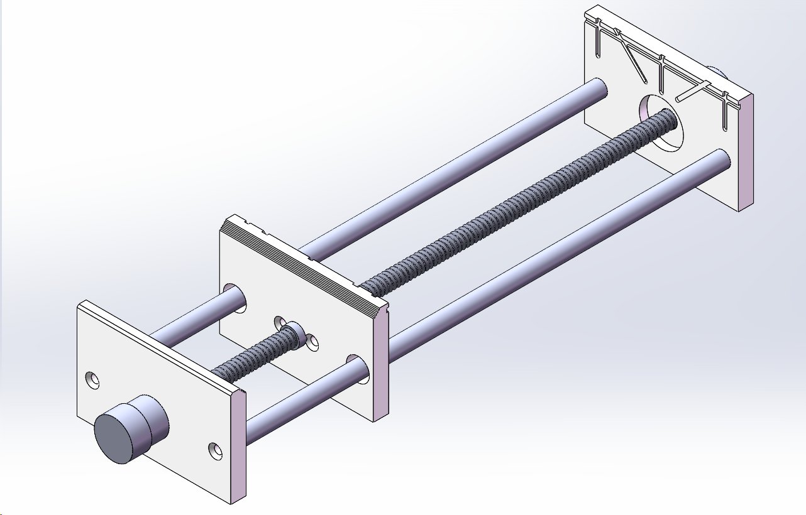

# PCB 焊接夹具（PCB Soldering Fixture）

基于五金标准件 + 少量 CNC 件的 PCB 焊接夹具，用于贴片返修、手工焊接和刷钢网时的板子固定。

结构参考了嘉立创工坊和开源社区的成熟方案，在其基础上做了二次开发：**零件更易购买、夹持尺寸可扩展、夹持面与台面齐平（可架钢网）、整机成本控制在 40 元左右**。



## 特点

- **低成本**：T6 版配件约 24–34 元，T8 版配件约 25–34 元，CNC 件一次做 3 块约 14 元。
- **易采购**：光轴、梯形丝杆、法兰、轴承、手轮全部是现货标准件，附完整购买清单和链接。
- **可扩展**：CNC 板宽由 6cm 加宽到 8cm；T8 版 8mm 光轴可按需更换为 10mm 光轴提升刚性。
- **夹持齐平**：一侧改成台阶式夹持，夹住板子后上表面与夹具顶面齐平，方便刮锡膏、架钢网。
- **无底板**：靠两根光轴支撑，省掉大尺寸底板，桌面占用小，也不受 CNC 尺寸上限限制。

## 版本对比

| 版本 | 光轴 | 丝杆 | 整机尺寸 | 配件成本 | 适用场景 |
| --- | --- | --- | --- | --- | --- |
| [T6 版本](夹具3D模型/T6版本) | 6mm × 2 | T6 梯形丝杆 | 约 100mm 级 | 24–34 元 | 小板、桌面空间有限 |
| [T8 版本](夹具3D模型/T8版本) | 8mm × 2（可升级 10mm） | T8 梯形丝杆 | 约 300mm 级 | 25–34 元 + CNC 14 元 | 通用，大板也能夹 |
| [T8 矮版](夹具3D模型/T8版本_矮) | 8mm × 2 | T8 梯形丝杆 | 低矮结构 | 同上 | 需要更低夹持高度 |

两个版本共用同一套标准件逻辑，区别只在 CNC 板（固定板前 / 固定板后 / 活动板）的尺寸和孔径。T8 版性价比更高，按实际板子尺寸选择即可。

## 目录结构

```text
.
├── README.md
├── PCB焊接夹具.md            # 详细设计记录：需求分析、方案调研、迭代过程
├── PCB焊接夹具/              # 文章配图与实物照片
├── 夹具3D模型/
│   ├── T6版本/
│   │   ├── STEP文件/         # CNC 加工用（上传嘉立创下单）
│   │   ├── 其它配件/         # 标准件模型（光轴、丝杆、轴承、手轮、法兰）
│   │   └── 整体装配.SLDASM
│   ├── T8版本/
│   └── T8版本_矮/
└── 参考建模/                 # 参考的第三方设计原始文件（版权归原作者）
```

## 快速开始

1. **选版本**：根据要夹的 PCB 尺寸选 T6 或 T8，到 `夹具3D模型/<版本>/STEP文件/` 取 CNC 板文件。
2. **下单 CNC**：材料建议 6061 铝合金，一次做 3 块摊薄成本（嘉立创 CNC 记录约 14 元/次）。STEP 文件可直接上传，不需要再导图。
3. **买标准件**：清单和购买链接见 [PCB焊接夹具.md](PCB焊接夹具.md) 的「资料打包」一节，T8 / 220mm 光轴版本全套约 40 元（叠券约 28 元）。
4. **装配**：
   - 两根光轴穿过后固定板 → 活动板 → 前固定板，两端用沉头螺丝固定；
   - 丝杆穿过前固定板的推力轴承，旋入活动板上的梯形螺母，外端装手轮；
   - 活动板两侧配石墨自润滑铜套，保证滑动顺畅不晃动。

> T8 版的 CNC 文件以带 `_V0.1` 后缀的为准，已按 V1.1 迭代修正丝杆螺母安装孔径（10.5mm）和轴承内孔，可直接下单。

## 迭代记录

### V1.1

1. 梯形丝杆螺母安装孔径改为 10.5mm——实测原孔径偏小，无法直接装入，需要打磨。
2. 修正两侧轴承内孔，避免与外壳摩擦。
3. 改版已完成装配验证。

## 关于模型文件

- **STEP（.STEP）**：CNC 加工和跨软件查看用，纯文本、体积小，是给别人用的格式。
- **SLDPRT / SLDASM**：SolidWorks 源文件，可继续编辑。装配体里保存的是零件路径引用，换机器打开可能提示找不到零件，请把整个版本目录一起拷贝。
- 推荐优先使用 STEP 文件，除非需要改动结构。

## 参考资料与致谢

本项目的结构思路来自以下方案，感谢原作者：

1. [PCB 夹具 - A锋 - 嘉立创 FA 商城](https://www.jlc-jdgf.com/machine-detail/576368165096771587) — 磁吸旋转底板 + 三区对向夹持。
2. [PCB 夹具 - 嘉立创 FA 商城](https://www.jlc-jdgf.com/machine-detail/564835813840285698) — 用 2020 型材替代底板，降低成本。
3. [zhangbokang/PCB_Fixture](https://github.com/zhangbokang/PCB_Fixture) — 全标准件 + 两片 CNC 的极简结构。
4. [成功复刻改版 T6 小夹具 - 哔哩哔哩](https://www.bilibili.com/video/BV1nPkCBZEem/) — T6 小夹具，去掉底板、改为台阶式夹持。

`参考建模/` 目录中的压缩包为上述设计的原始文件，**版权归原作者所有**，此处仅作学习与复现参考，请勿用于商业用途或二次分发。

## 许可

本项目自研部分（CNC 板设计、装配说明、文档）采用 [CC BY-NC-SA 4.0](https://creativecommons.org/licenses/by-nc-sa/4.0/deed.zh) 许可，可自由复制、修改、非商业使用，需署名并以相同方式共享。如需商用请联系作者。
